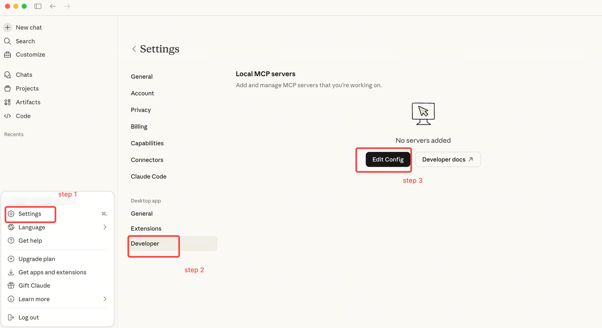
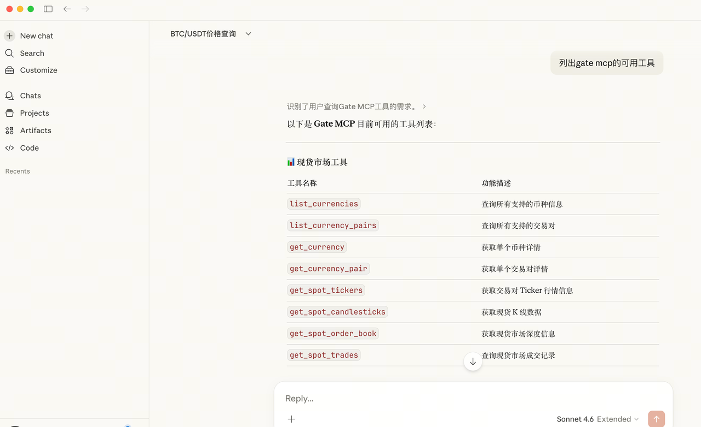
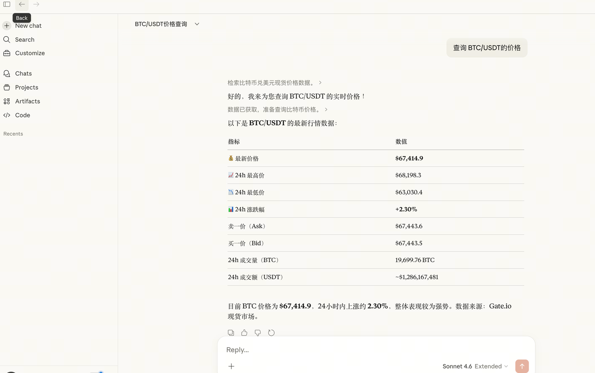

# Claude Desktop 配置指南

## 方式一：远程 custom connector

Claude Desktop 支持远程 MCP custom connector；本地 stdio 代理不是必需条件。按 [Claude 官方说明](https://support.claude.com/en/articles/11175166-get-started-with-custom-connectors-using-remote-mcp) 添加连接，组织账户需遵守管理员的 connector 权限。

| 用途 | 远程 URL | 认证 |
|---|---|---|
| CEX 公开数据 | `https://api.gatemcp.ai/mcp` | 无 |
| 授权范围内的 CEX 私有工具 | `https://api.gatemcp.ai/mcp/exchange` | Gate OAuth2 |

选择私有端点时完成客户端提示的 Gate 授权，再检查实际可见工具。公开端点和私有端点分别添加；客户端及账户权限可能影响接入，官方支持不代表所有 Gate 账户组合均已验收。

## 方式二：公开数据的本地 stdio 兼容代理

以下步骤使用本仓库维护的 [Python 代理](../gate-mcp-proxy.py)，默认连接公开 `/mcp`。代理不实现 OAuth 或 SSE 解析，不能仅将 URL 改成私有端点就取得交易权限。

### 第 1 步：下载 Python 代理

```bash
# 下载唯一维护的代理文件，避免复制另一份实现。
curl -O https://raw.githubusercontent.com/gate/gate-mcp/main/gate-mcp-proxy.py
```

### 第 2 步：编辑 Claude Desktop 配置

打开 Claude Desktop 配置文件：

- **macOS**: `~/Library/Application Support/Claude/claude_desktop_config.json`
- **Windows**: `%APPDATA%\Claude\claude_desktop_config.json`



添加以下配置（将 `/path/to/gate-mcp-proxy.py` 替换为实际路径）：

```json
{
  "mcpServers": {
    "Gate": {
      "command": "python3",
      "args": ["/path/to/gate-mcp-proxy.py"]
    }
  }
}
```

### 第 3 步：重启并验证

1. **完全重启 Claude Desktop**
2. 打开新的对话
3. 尝试："列出 gate mcp 的可用工具"



### 第 4 步：开始使用

示例查询：

- "查询 BTC/USDT 的当前价格"
- "显示 ETH/USDT 的资金费率"
- "获取最近 24 小时的强平历史"



## 故障排除

### "Cannot find module" 错误

确保 Python 3 已安装并可访问：

```bash
python3 --version
```

### Permission Denied

使代理脚本可执行：

```bash
chmod +x /path/to/gate-mcp-proxy.py
```

### 连接超时

1. 检查网络连接
2. 验证 MCP 服务器 URL 是否可访问
3. 检查防火墙是否阻止连接

## 下一步

- 探索所有[可用工具](../README_zh.md#工具列表)
- 了解[合约工具](../README_zh.md#cex-public)
- 查看 [API 文档](https://www.gate.com/docs/developers/apiv4/)
