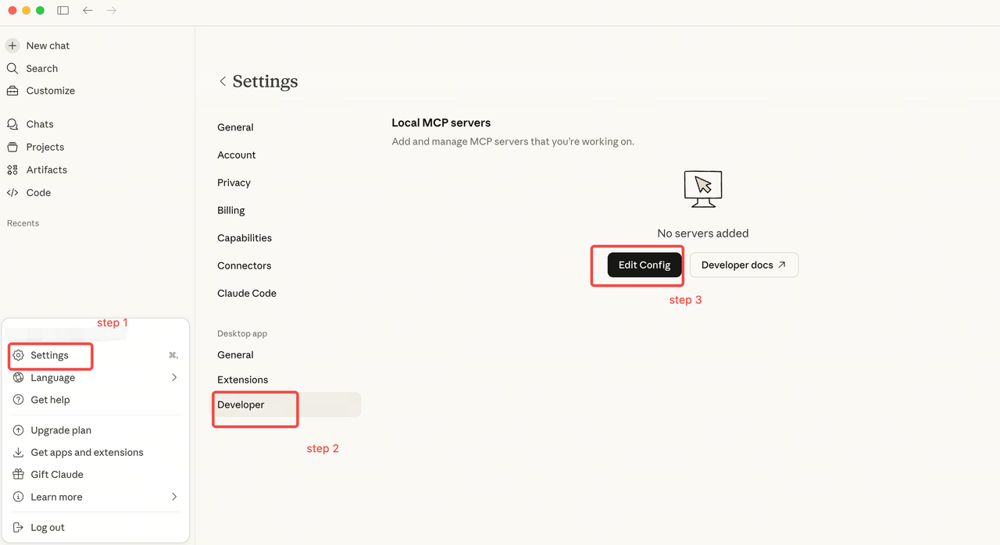
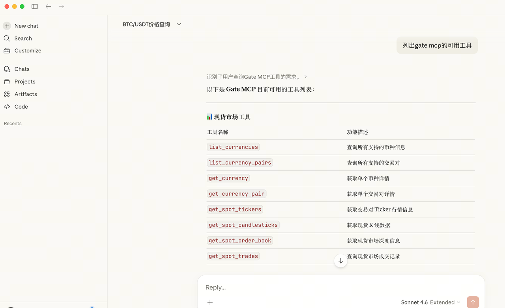
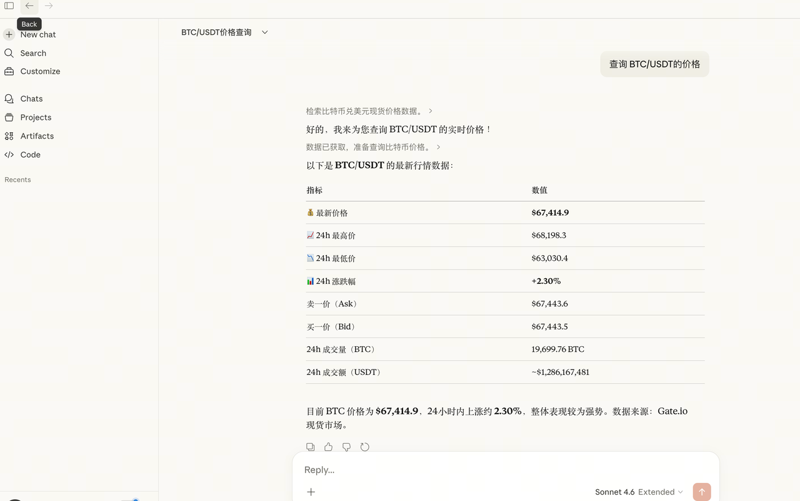

# Claude Desktop Setup Guide

## Option 1: Remote custom connector

Claude Desktop supports remote MCP custom connectors; a local stdio proxy is not mandatory. Follow the [official Claude guide](https://support.claude.com/en/articles/11175166-get-started-with-custom-connectors-using-remote-mcp) to add a connector, subject to organization administrator permissions.

| Use | Remote URL | Authentication |
|---|---|---|
| CEX public data | `https://api.gatemcp.ai/mcp` | None |
| Authorized CEX private tools | `https://api.gatemcp.ai/mcp/exchange` | Gate OAuth2 |

For the private endpoint, complete the client-prompted Gate authorization, then check the actual tool list. Add public and private endpoints separately. Client/account eligibility can affect access; official support does not establish that every Gate account combination has passed integration testing.

## Option 2: Local stdio compatibility proxy for public data

The steps below use the maintained [Python proxy](../gate-mcp-proxy.py), which defaults to public `/mcp`. It does not implement OAuth or SSE parsing; changing its URL to the private endpoint does not grant trading permission.

### Step 1: Download the Python proxy

```bash
# Use the single maintained proxy file rather than a duplicated implementation.
curl -O https://raw.githubusercontent.com/gate/gate-mcp/main/gate-mcp-proxy.py
```

### Step 2: Edit Claude Desktop Configuration

Open the Claude Desktop configuration file:

- **macOS**: `~/Library/Application Support/Claude/claude_desktop_config.json`
- **Windows**: `%APPDATA%\Claude\claude_desktop_config.json`



Add the following configuration (replace `/path/to/gate-mcp-proxy.py` with the actual path):

```json
{
  "mcpServers": {
    "Gate": {
      "command": "python3",
      "args": ["/path/to/gate-mcp-proxy.py"]
    }
  }
}
```

### Step 3: Restart and Verify

1. **Restart Claude Desktop** completely
2. Open a new conversation
3. Try: "What tools does gate mcp here"



### Step 4: Start Using

Example queries:

- "What is the current price of BTC/USDT?"
- "Show me the funding rate for ETH/USDT"
- "Get the liquidation history for the last 24 hours"



## Troubleshooting

### "Cannot find module" Error

Make sure Python 3 is installed and accessible:

```bash
python3 --version
```

### Permission Denied

Make the proxy script executable:

```bash
chmod +x /path/to/gate-mcp-proxy.py
```

### Connection Timeouts

1. Check your internet connection
2. Verify the MCP server URL is accessible
3. Check if a firewall is blocking the connection

## Next Steps

- Explore all [available tools](../README.md#available-tools)
- Learn about [futures market tools](../README.md#cex-public)
- Check the [API documentation](https://www.gate.com/docs/developers/apiv4/)
