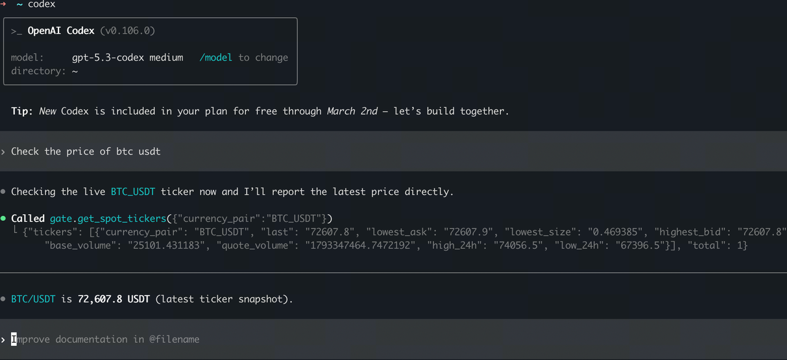

# Codex CLI 配置指南

## 方式一：一键安装

在 AI 对话中输入：

> Help me auto install Gate Skills and MCPs: https://github.com/gate/gate-skills

## 方式二：手动配置

### 前置条件

- 可使用 Codex 的 ChatGPT 登录，或用于 API 计费的 OpenAI API Key
- Node.js >= 18

### 第 1 步：安装 Codex CLI

全局安装 OpenAI Codex CLI：

```bash
npm install -g @openai/codex
```

或使用 npx（无需安装）：

```bash
npx @openai/codex --version
```

### 第 2 步：登录 Codex

Codex 支持 ChatGPT 登录和 API Key 登录，见 [OpenAI 官方认证说明](https://learn.chatgpt.com/docs/auth)。这与稍后使用的 Gate OAuth2 是两次独立授权。

```bash
# 使用 ChatGPT 账号完成 Codex 浏览器登录。
codex login
```

若选择 API Key 方式，先在本机私密环境中设置 OPENAI_API_KEY，再通过 stdin 登录：

```bash
# 不将密钥值写入命令行参数或文档。
printenv OPENAI_API_KEY | codex login --with-api-key
```

### 第 3 步：添加 Gate MCP

**完整交易能力（OAuth）：**

```bash
codex mcp add gate --url https://api.gatemcp.ai/mcp/exchange
```

**仅查行情（无需认证）：**

```bash
codex mcp add gate --url https://api.gatemcp.ai/mcp
```

**Info（无需认证）：**

```bash
codex mcp add gate-info --url https://api.gatemcp.ai/mcp/info
```

**News（无需认证）：**

```bash
codex mcp add gate-news --url https://api.gatemcp.ai/mcp/news
```


添加时可能提示 Gate OAuth。若尚未完成授权或需要重新登录，可执行：

```bash
# 此命令授权 Gate MCP，不是登录 Codex 账号。
codex mcp login gate
```

以当前客户端实际提示和 [OpenAI MCP 说明](https://learn.chatgpt.com/docs/extend/mcp) 为准；不要仅凭配置出现在列表中就判定业务权限齐全。

### 第 4 步：验证安装

列出所有配置的 MCP 服务器：

```bash
codex mcp list
```

你应该能在列表中看到 Gate MCP 服务器。


### 第 5 步：开始使用

启动 Codex CLI：

```bash
codex
```

尝试以下示例查询：

- "查询 BTC/USDT 的当前价格"
- "帮我查下 Gate 有什么套利空间？"
- "帮我分析一下 SOL"
- "Gate 有没有新币值得关注？"



## 更新 MCP 服务器

如需更新 MCP 服务器 URL 或配置：

```bash
codex mcp remove gate
codex mcp add gate --url https://api.gatemcp.ai/mcp/exchange
```

## 故障排除

### API Key 登录错误

仅在选择 API Key 登录方式时检查 OpenAI API 密钥；ChatGPT 登录不要求该环境变量：

```bash
export OPENAI_API_KEY="your-api-key-here"
```

### MCP 服务器未找到

1. 检查 MCP 是否正确添加：`codex mcp list`
2. 尝试移除并重新添加 MCP
3. 检查网络连接

### 连接错误

1. 验证 URL 是否正确：`https://api.gatemcp.ai/mcp/exchange`（交易）或 `https://api.gatemcp.ai/mcp`（行情）
2. 检查是否需要代理或 VPN
3. 稍后再试（服务器可能暂时不可用）

## 下一步

- 探索所有[可用工具](../README_zh.md#工具列表)
- 了解[合约工具](../README_zh.md#cex-public)
- 查看 [API 文档](https://www.gate.com/docs/developers/apiv4/)
