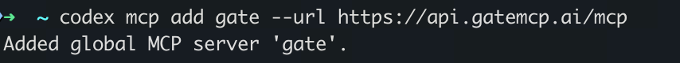
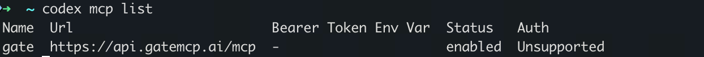
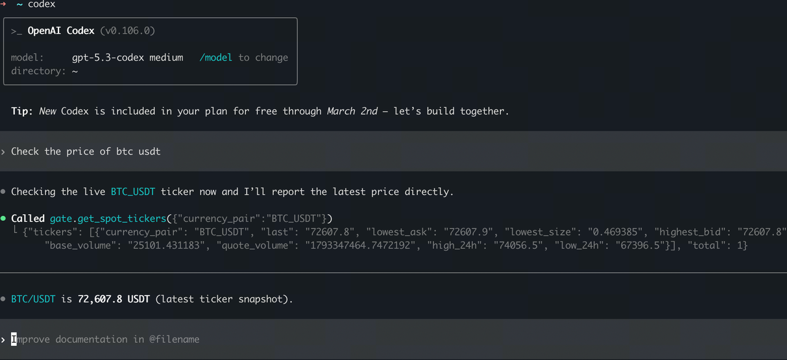

# Codex CLI Setup Guide

## Method 1: One-click Install

In the AI chat, type:

> Help me auto install Gate Skills and MCPs: https://github.com/gate/gate-skills

## Method 2: Manual Configuration

### Prerequisites

- ChatGPT sign-in with Codex access, or an OpenAI API key for API-billed use
- Node.js >= 18

### Step 1: Install Codex CLI

Install the OpenAI Codex CLI globally:

```bash
npm install -g @openai/codex
```

Or use npx (no installation required):

```bash
npx @openai/codex --version
```

### Step 2: Sign in to Codex

Codex supports ChatGPT sign-in and API-key sign-in; see [official OpenAI authentication](https://learn.chatgpt.com/docs/auth). This is separate from Gate OAuth2 authorization below.

```bash
# Complete Codex browser login with a ChatGPT account.
codex login
```

For API-key sign-in, first set OPENAI_API_KEY privately on your machine, then pass it through stdin:

```bash
# Keep the key value out of command arguments and documentation.
printenv OPENAI_API_KEY | codex login --with-api-key
```

### Step 3: Add Gate MCP

**For full trading (OAuth on connect):**

```bash
codex mcp add gate --url https://api.gatemcp.ai/mcp/exchange
```

**For market data only (no auth):**

```bash
codex mcp add gate --url https://api.gatemcp.ai/mcp
```

**For Info (no auth):**

```bash
codex mcp add gate-info --url https://api.gatemcp.ai/mcp/info
```

**For News (no auth):**

```bash
codex mcp add gate-news --url https://api.gatemcp.ai/mcp/news
```



Adding the server may prompt Gate OAuth. If authorization is incomplete or needs renewal, run:

```bash
# Authorize Gate MCP; this does not sign in to the Codex account.
codex mcp login gate
```

Follow the installed client's prompts and [official MCP documentation](https://learn.chatgpt.com/docs/extend/mcp). A saved configuration alone does not establish complete business permissions.

### Step 4: Verify Installation

List all configured MCP servers:

```bash
codex mcp list
```

You should see the Gate MCP server in the list.



### Step 5: Start Using

Launch the Codex CLI:

```bash
codex
```

Try these example queries:

- "What is the current price of BTC/USDT?"
- "Show me arbitrage opportunities on Gate"
- "Analyze SOL for me"
- "Any new coins on Gate worth watching?"



## Updating the MCP Server

To update the MCP server URL or configuration:

```bash
codex mcp remove gate
codex mcp add gate --url https://api.gatemcp.ai/mcp/exchange
```

## Troubleshooting

### API-key sign-in errors

Check the API key only when using API-key sign-in. ChatGPT sign-in does not require this environment variable:

```bash
export OPENAI_API_KEY="your-api-key-here"
```

### MCP Server Not Found

1. Check if the MCP is properly added: `codex mcp list`
2. Try removing and re-adding the MCP
3. Check your internet connection

### Connection Errors

1. Verify the URL is correct: `https://api.gatemcp.ai/mcp/exchange` (trading) or `https://api.gatemcp.ai/mcp` (market data)
2. Check if you need a proxy or VPN
3. Try again later (the server might be temporarily down)

## Next Steps

- Explore all [available tools](../README.md#available-tools)
- Learn about [futures market tools](../README.md#cex-public)
- Check the [API documentation](https://www.gate.com/docs/developers/apiv4/)
